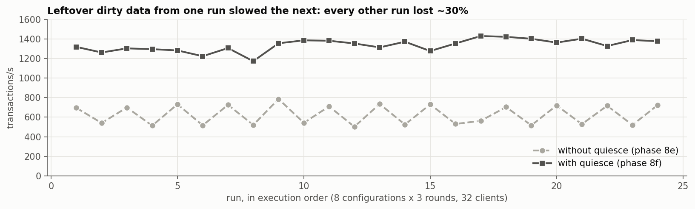
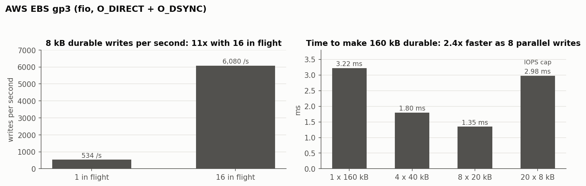
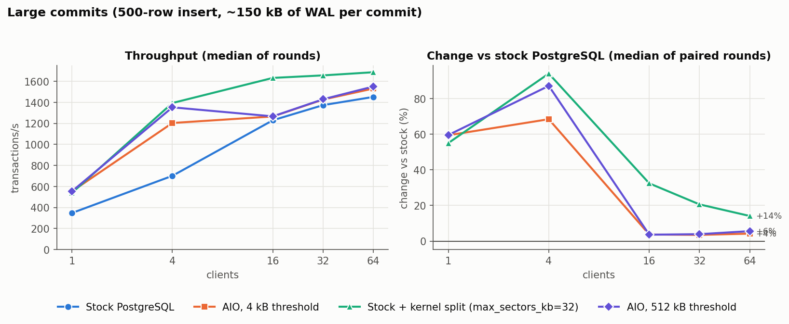
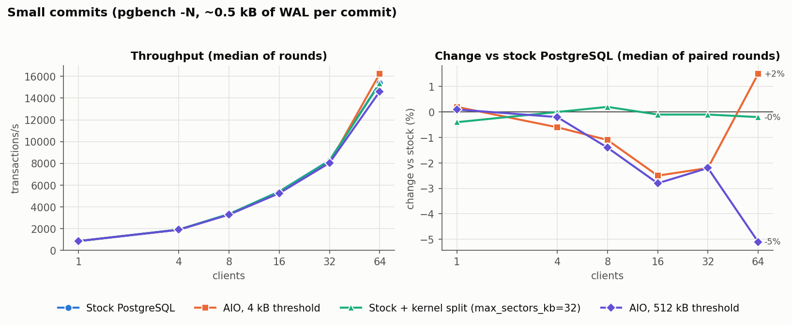
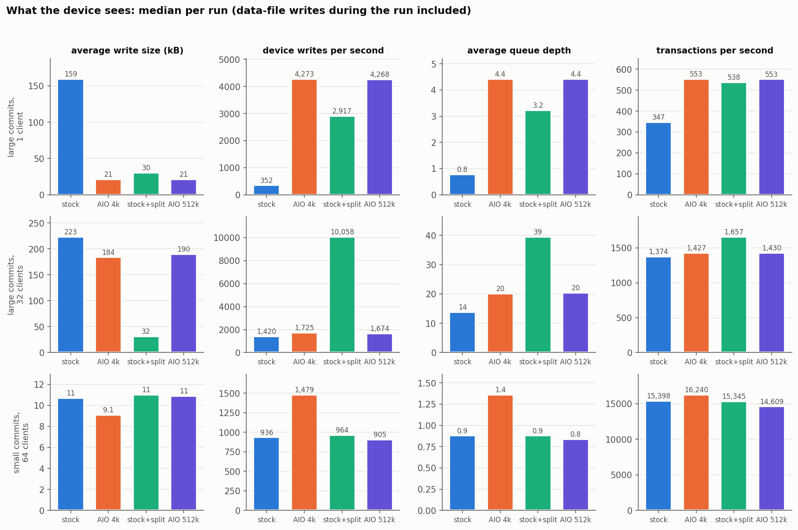
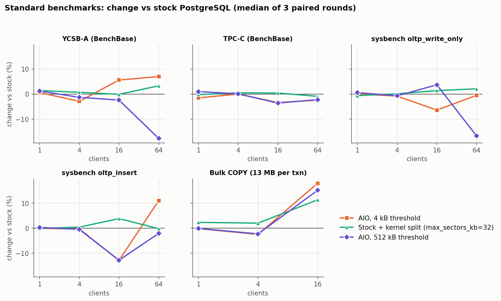
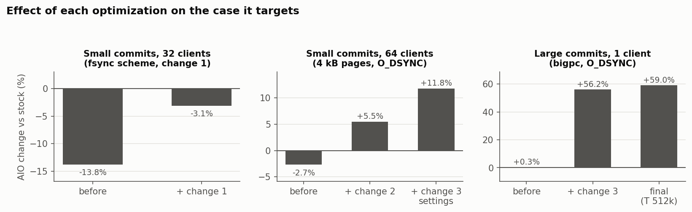

# Asynchronous WAL Writes in PostgreSQL on Cloud Block Storage

CS631 project report, part 2: optimization and evaluation on AWS EBS gp3
(November 2026). Part 1 (`../report.pdf`) covers the design, the first
implementation and the NVMe measurements. This report covers what came
after: the move to network storage, three optimizations, the correctness
testing of each, and benchmarks with PostgreSQL's own workloads and with
standard OLTP benchmarks (TPC-C, YCSB, sysbench, bulk load).

Detailed per-phase log with every table: `results-aws/FINDINGS.md`.
Correctness results: `results3/README.md`.

---

## 1. Summary

- **What was built.** `wal_io_method = aio` lets PostgreSQL issue WAL writes
  through its AIO subsystem (io_uring or IO workers) instead of the blocking
  `pwrite()` + `fdatasync()` under `WALWriteLock`. Several WAL writes can be
  in flight at once; a range tracker advances the durable `Flush` pointer only
  over the contiguous prefix of completed writes.
- **Storage.** On local NVMe (part 1) AIO could at best match stock: that
  device executes durable writes one at a time. AWS EBS gp3 is network
  storage that does overlap them: 534 durable 8 kB writes/s at queue depth
  1, 6,080/s at queue depth 16 (11x). It is the kind of storage AIO WAL is
  meant for.
- **Three optimizations**, each a new setting, default off:
  1. *Inline eager issue* (`wal_io_eager_issue` + `wal_io_inline_fsync`):
     removes a 0.1 ms hand-off gap between flushes (32 clients: -13.8% ->
     -3.1%), but costs 8 clients; off by default.
  2. *Page-aligned pipelining* (`wal_io_page_align`): writes in flight never
     share a WAL page, so full pages can go out while a write is in flight.
     First small-commit win: **+5.5% at 64 clients** (later +11.8% with change 3
     settings).
  3. *Split writes* (`wal_io_split_size`): a large flush is issued as several
     parallel whole-page writes. **Large commits: +56% at 1 client, +84-87% at 4,
     +8-20% at 16-32**, winning every round.
- **Correctness.** Every change passed the full suite (regression, crash,
  chaos reloads, replication, power cuts) on release and assert builds:
  **450 test runs, 2,280 crashes or power cuts, 1.16 million acknowledged
  commits verified, 0 lost.** One durability bug (after a `wal_sync_method` reload)
  was found by the tests and fixed.
- **The honest comparison.** Tuning stock with one kernel setting
  (`max_sectors_kb = 32` on the WAL device) gives stock the same large-commit
  gain (+56% / +90% / +38% / +27%). Change 3's gain comes from splitting large
  writes into parallel requests, which the block layer can also do. What
  stock cannot do is overlap *small* commits: there AIO keeps a real gain
  (+11.8% pgbench at 64 clients, +7% YCSB-A at 64 clients).
- **Open problem.** No single `wal_io_pipeline_threshold` is best for both:
  large commits want 512 kB (batch several commits per flush), small commits
  want 4 kB (pipeline single pages). With 512 kB, YCSB-A loses 18% at 64
  clients. An adaptive threshold is the next step.
- **Method lessons.** Three harness flaws were found and fixed along the way:
  cross-run interference from leftover dirty data (made all earlier 16-32
  client results unreliable), cold page caches for read-heavy benchmarks
  (made TPC-C bimodal), and canary-only device gating. Section 6.

---

## 2. Background: why WAL writing is a bottleneck

Every PostgreSQL commit waits until its commit record is durable
(`XLogFlush`). Stock PostgreSQL does this synchronously: one backend at a
time takes `WALWriteLock`, writes all WAL inserted so far (`pwrite`), makes
it durable (`fdatasync`, or `O_DSYNC` writes), and releases the lock.
Everyone whose record was included returns without I/O: that is **group
commit**.

Two consequences:

1. **One flush in flight.** Storage that can run many durable writes in
   parallel sees one at a time.
2. **Late arrivals pay double.** A commit that arrives while a flush is in
   progress waits for it and then for a full flush of its own.

On local NVMe the flush is fast (tens of microseconds) and the device
serializes flushes anyway. On cloud block storage a durable write takes
about 1.9 ms (gp3, measured) and the device can overlap many: there, the
synchronous design leaves most of the device's parallelism unused.

---

## 3. Design and implementation

All changes are in `src/backend/access/transam/xlog.c` (plus GUC
definitions, docs and an fsync operation in the AIO subsystem).

### 3.1 Issue and completion

`XLogFlushAio()` replaces the synchronous path when `wal_io_method = aio`:

- **Issue.** A backend that needs WAL durable takes `WALWriteLock` only to
  *start* writes (`XLogAioIssue`): it collects contiguous WAL pages into one
  IO, up to its target, the end of the WAL buffer ring, a segment end or
  32 MB, and submits it through `pgaio_*`. Then it releases the lock.
- **Completion.** Each write's completion marks its range done in a small
  shared ring (the in-flight tracker). `Flush` advances to the end of the
  longest run of completed writes starting at the current `Flush`, never
  further. Waiters sleep on a condition variable until `Flush` passes their
  LSN.
- **Bound.** `wal_io_max_inflight` (1-64) caps the writes in flight, so WAL
  cannot exhaust the AIO handles that data I/O needs.

### 3.2 Two durability schemes

| `wal_sync_method` | scheme | what is asynchronous |
|---|---|---|
| `open_datasync` / `open_sync` | **O_DSYNC**: each write is durable when it completes (with direct IO, one FUA write) | the writes |
| `fdatasync` / `fsync` (Linux default) | **fsync**: writes go to the page cache synchronously, then one AIO fsync covers them | the fsync |

### 3.3 Dependencies between writes

Out-of-order completion is safe because of the contiguous-prefix rule
above. The other dependency is between writes that touch the same bytes:

- **A write never overlaps the bytes of a write in flight.** Two writes of
  the same page in flight could complete in either order, and the older
  content could win on disk.
- **Direct IO writes whole pages**, so a write that starts in the middle of
  the last page (the usual case: the previous flush ended mid-page) must
  wait for the write that covers that page.
- **Zeroing.** The first write to reach a page also writes zeros for the
  rest of the page, so stale bytes from a recycled segment are never read
  as WAL after a crash. Later writes of that page wait for the zeroing write
  (`aioZeroedUpTo`, `XLogAioWaitForZeroingWrite`), and that waiting happens
  before `WALWriteLock` is taken (or with release and retry).
- **Pipeline threshold** (`wal_io_pipeline_threshold`, default 256 kB):
  while a write is in flight, a new one is started only if at least this
  much unwritten WAL is waiting; otherwise the flush waits and joins the
  next write. This keeps group commit: without it, every small commit
  becomes its own trip to storage (measured: -34% to -74%).

### 3.4 Settings

| setting | default | meaning |
|---|---|---|
| `wal_io_method` | `sync` | `aio` enables the new path (restart) |
| `wal_io_max_inflight` | 1 | max WAL writes in flight |
| `wal_io_pipeline_threshold` | 256 kB | min unwritten WAL to start a write while one is in flight |
| `wal_io_inline_fsync` | on | the backend that needs an fsync / last O_DSYNC write runs it itself after releasing the lock |
| `wal_io_eager_issue` | off | change 1 (section 4.1) |
| `wal_io_page_align` | off | change 2 (section 4.2) |
| `wal_io_split_size` | 0 (off) | change 3 (section 4.3) |

---

## 4. Optimizations

Each change was motivated by a measurement, tested for correctness, then
benchmarked against stock in the same run.

### 4.1 Change 1: inline eager issue

**Problem** (phase 2b). At 32 clients AIO lost 13% to stock. Profiling ruled
out extra wake-ups, smaller groups and slower fsyncs. The cause was the
**gap between one fsync ending and the next starting: 0.143 ms vs 0.041 ms
for stock**. After an fsync, all ~31 waiters woke and raced through the
issue path before one of them started the next write; in stock the next
leader is already queued on the lock.

**Change.** With `wal_io_eager_issue = on`, the backend that sees its WAL
durable starts the next write itself, inline, without the io_uring
hand-off.

**Result.** Gap back to 0.054 ms; 32 clients **-13.8% -> -3.1%**. But 8
clients went -2.4% -> -13.1% (that backend's own client now waits one extra
flush). A trade, not a win: off by default.

### 4.2 Change 2: page-aligned pipelining

**Problem** (phase 4). With 4 kB WAL pages and a 4 kB threshold (the idea:
batch within a page, pipeline complete pages), results were identical to a
256 kB threshold. Almost every write ends mid-page, so the next write
starts in that page and must wait (section 3.3): no second write was ever
in flight.

**Change** (`wal_io_page_align`, O_DSYNC scheme). While a write is in
flight, a new write ends at the last complete page; the partial page waits
for a later write. Writes in flight then never share a page. With nothing
in flight, everything is written as before.

**Result** (pgbench -N, 4 kB pages, direct IO). 64 clients: **-2.7% ->
+5.5%, 6 of 6 rounds** (18,738 vs 17,793 TPS). Neutral at 1-32 clients: a
group there carries less than one page past the write in flight, so there
is no full page to pipeline. The replication test saw up to 4 writes in
flight (1-2 before).

### 4.3 Change 3: split large writes

**Problem** (phase 8a). One flush is always one IO, however many pages it
covers. On gp3, fio shows a single 160 kB durable write takes **3.22 ms**,
but 8 parallel 20 kB writes finish in **1.35 ms (2.4x faster)**. And a
large commit (bigpc: 500-row insert, ~150 kB WAL) spends ~60% of its time
waiting for that one write (synchronous vs asynchronous commit: 313 vs 779
TPS at 1 client).

**Change** (`wal_io_split_size`, O_DSYNC scheme). A flush of at least twice
the split size is issued as several whole-page writes, at most as many as
`wal_io_max_inflight` has free slots. Only the first chunk can start
mid-page and only the last can end mid-page, so the chunks share no page
and run in parallel. `Flush` still advances only over the contiguous
completed prefix, so durability is unchanged.

**Result** (bigpc, best settings from a 7-config screening: threshold
512 kB, split 16 kB, 8 in flight; phase 9 run):

| vs stock | 1 client | 4 | 16 | 32 |
|---|---:|---:|---:|---:|
| AIO + change 3 | **+59.0%** [6/6] | **+83.8%** [6/6] | **+19.8%** [6/6] | **+11.7%** [6/6] |

TPS 329 -> 521 at 1 client (commit latency ~3.1 ms -> ~2.0 ms), 714 ->
1,311 at 4. The threshold matters at high concurrency: a 512 kB threshold
batches several commits into one flush (fewer IOs), the split keeps that
flush parallel.

---

## 5. Correctness

**Suite** (`tests/`, `run_all.py`), run for every change on release and
debug + cassert builds, for every affected configuration (`tests/modes.txt`):

| test | what it does |
|---|---|
| `regress` | PostgreSQL regression + isolation suites (373 tests) |
| `crash` | SIGKILL of every process / of the postmaster, alternating, during load; after recovery every acknowledged commit must be present |
| `chaos` | crashes while `wal_io_*` settings and `wal_sync_method` are reloaded at random |
| `reload` | `wal_sync_method` switched between the two durability schemes at runtime |
| `repl` | streaming standby + WAL archive + promotion |
| power cut | dm-flakey drops every write from the cut on and the page cache is lost; negative control: `fsync = off` fails at the first cut |

After every recovery, `amcheck` (B-tree and heap) must be clean and no log
may contain a PANIC or an assertion failure.

| code | runs passed | crashes / power cuts | acknowledged commits verified | lost |
|---|---:|---:|---:|---:|
| base (before changes) | 210 / 210 | 1,092 | 546,026 | 0 |
| change 1 | 67 / 67 | 330 | 169,458 | 0 |
| change 2 | 80 / 80 | 396 | 208,165 | 0 |
| change 3 | 93 / 93 | 462 | 238,889 | 0 |

**Bug found and fixed** (`5a78e355b7`): in the fsync scheme, after
`wal_sync_method` was reloaded to an O_DSYNC method, WAL files opened before
the reload lacked O_DSYNC, so acknowledged commits were not durable. Found
by `chaos` under power cut, then reproduced deterministically by `reload`.

---

## 6. Experimental method

### 6.1 Platform

| | |
|---|---|
| VM | AWS `c6i.2xlarge` (8 vCPU Xeon 8375C, 16 GB), Sydney, Ubuntu 24.04 |
| storage | EBS gp3, 100 GB, 6,400 IOPS, 300 MiB/s, XFS (reflink), WAL and data on the same volume |
| builds | release (`-O3`, liburing); 4 kB WAL pages (`-Dwal_blocksize=4`) from phase 4 on; `stock4` = upstream base, `aio4` = this work |
| common settings | `shared_buffers = 512MB`, `wal_buffers = 64MB`, `max_wal_size = 8GB`, `full_page_writes = off`, `autovacuum = off`; durability: `wal_sync_method = open_datasync`, `debug_io_direct = wal` for stock and AIO |

### 6.2 Harness (`bench/bench.sh`, `bench/analyze.py`)

- **Paired, interleaved runs.** All configurations' servers run at the same
  time on their own data directories (reflink copies of one golden
  directory). For each round and client count, each configuration gets one
  run, seconds apart, in an order rotated every round. So drift in the
  network storage's speed affects all configurations alike.
- **Statistic.** For each round, each configuration's throughput is divided
  by the stock baseline's from the same round; the table value is the
  **median of these ratios**, with `[rounds won / rounds]`. A consistent
  [6/6] or [0/6] is a real effect; 2-4 of 6 is noise.
- **Device gate.** Before each block of runs, a canary (200 x 8 kB O_DSYNC
  writes) must be below a latency limit, or the harness waits.
- **Quiesce (`QUIESCE=1`).** After each run: `CHECKPOINT` that server and
  `sync` (section 6.3).
- **Prewarm** (standard workloads). Before measuring: drop the page cache,
  then read each configuration's copy of the workload's tables and indexes
  into it (section 6.3).
- **Kernel settings per configuration.** `sys.max_sectors_kb = N` in a
  configuration line sets the device's maximum request size before each of
  its runs, restored afterwards.

### 6.3 Harness flaws found and fixed

1. **Cross-run interference** (phase 8e). At 32 clients, throughput
   alternated ~520 / ~720 TPS by *position in the run order*, whatever the
   configuration. A heavy run left 300-500 MB of dirty data that the kernel
   wrote out during the next server's run. Fix: quiesce after each run.
   Afterwards, 32-client throughput was 1,170-1,430 TPS in every run, and AIO
   won 63 of 63 screening cells. **All 16-32 client results before phase 8f
   are unreliable** (section 7 uses only quiesced runs for those).
2. **Cold page caches** (phase 10). Each configuration's TPC-C copy (1.6 GB)
   was read from the device during the runs; reads competed with WAL writes
   for IOPS and TPC-C results were bimodal (~1,020 or ~1,350 requests/s,
   even for configurations that cannot differ). Fix: prewarm; afterwards the
   device does 0 reads/s during runs.
   
3. **Small-sample screening.** 3-round screenings were used only to choose
   configurations; final numbers come from 6-round runs.

---

## 7. Stock vs AIO: results and explanations

### 7.1 The configurations compared

All use 4 kB WAL pages, `wal_sync_method = open_datasync` and direct IO for
WAL, so the only difference is how WAL is written.

| name in figures | settings | what it represents |
|---|---|---|
| **Stock PostgreSQL** (blue, circle) | upstream code | the baseline every percentage is relative to |
| **AIO, 4 kB threshold** (orange, square) | all three changes: `wal_io_method = aio`, io_uring, `wal_io_page_align = on`, `wal_io_split_size = 16kB`, `wal_io_max_inflight = 8`, `wal_io_pipeline_threshold = 4kB` | AIO tuned for many small commits |
| **AIO, 512 kB threshold** (violet, diamond) | the same, `wal_io_pipeline_threshold = 512kB` | AIO tuned for large commits |
| **Stock + kernel split** (aqua, triangle) | upstream code, device `max_sectors_kb = 32` | the best tuning of stock found (phase 9) |

Stock with the Linux default `fdatasync` performs within a few percent of
stock with `open_datasync` + direct IO on this volume (phase 6), so the
baseline is representative.

### 7.2 What the storage rewards

Two facts explain almost every result below:

1. **Parallel durable writes are nearly free, up to the IOPS cap.** 16
   writes in flight give 11x the writes per second of 1, at only 40% more
   latency each (2.63 vs 1.87 ms). But the volume allows 6,400 IOPS in total,
   for WAL and data together.
2. **One large write is slow.** 160 kB as a single write takes 3.22 ms
   (its bytes go out serially); the same bytes as 8 parallel writes take
   1.35 ms. Splitting further (20 x 8 kB) hits the IOPS cap and gets slow
   again.

So AIO can only win where it turns serial device time into parallel device
time **without spending more IOs than the volume has**.

### 7.3 Large commits

*(Phase 9 data shown; phase 11, which adds the 4 kB AIO configuration, 64
clients and device counters, replaces it when finished.)*

| clients | stock TPS | AIO 512 kB | stock + kernel split |
|---:|---:|---:|---:|
| 1 | 329 | 521 (**+59%**) | 513 (+56%) |
| 4 | 714 | 1,311 (**+84%**) | 1,359 (+90%) |
| 16 | 1,183 | 1,417 (**+20%**) | 1,627 (+38%) |
| 32 | 1,303 | 1,448 (**+12%**) | 1,634 (+27%) |

**Why AIO gains at 1-4 clients (+59%, +84%).** A 500-row insert produces
~150 kB of WAL, and its commit must wait for all of it to be durable. Stock
issues that as **one** 150 kB write: ~3.2 ms on gp3. Change 3 issues it as
~9 writes of 16 kB that the volume runs in parallel: ~1.4-2 ms. Since ~60%
of the transaction's time is that wait (phase 8a: 313 TPS with synchronous
commit vs 779 without), commit latency drops from 3.1 to 2.0 ms and
throughput rises by the same ratio. At 4 clients the gain is larger still:
the 512 kB threshold also lets several clients' WAL go into one flush that
is then split, so the device runs both batching and parallelism.

**Why the gain shrinks at 16-32 clients (+20%, +12%).** The device itself
becomes the limit:

- *Bandwidth:* 1,450 TPS x ~150 kB = ~220 MB/s of WAL, plus the table
  writes, against the volume's 300 MiB/s.
- *IOPS:* splitting into 16 kB pieces multiplies the IO count. At high load
  the volume's 6,400 IOPS budget, shared with data writes, caps how much
  more parallelism helps.
- *In-flight cap:* AIO allows 8 writes in flight. Once 8 are out, further
  flushes wait.

**Why tuned stock does better at 16-32 clients.** `max_sectors_kb = 32`
makes the *kernel* split stock's large write into 32 kB requests, the same
idea as change 3. Its pieces are twice as large (half the IOs, so less IOPS
pressure) and the kernel has no in-flight cap. At 1-4 clients both are
equal: they do the same thing. *(Phase 11's device counters, IOs per second
and average size, test this explanation directly.)*

**Why the kernel split must not be too small.** `max_sectors_kb = 16`
splits *every* IO on the volume, data-file writes included: +65% at 1
client, but **-42% to -47% at 16-32 clients**, because the IO count exceeds
the IOPS cap. Change 3 avoids this by splitting only WAL flushes, and only
flushes of at least twice the split size.

### 7.4 Small commits

*(Phase 11, pgbench -N at 1-64 clients with all four configurations;
figure produced when the run finishes.)* Earlier runs of the same
configurations (phases 5 and 8d) showed:

| clients | 1 | 4 | 8 | 16 | 32 | 64 |
|---|---:|---:|---:|---:|---:|---:|
| AIO 4 kB threshold, vs stock | 0% | -1% | -2% | -4% | -8% | **+6% to +12%** |
| AIO 512 kB threshold, vs stock | | | | -4% | | **-4%** |

**Why there is no gain at 1-4 clients.** A pgbench transaction writes
~0.5 kB of WAL. With one client there is never a second commit to overlap
with: every commit waits for one ~1.9 ms device round trip, with or without
AIO. AIO only adds bookkeeping (in-flight tracker, condition-variable
wake-ups), hence 0% to -1%.

**Why AIO loses a little at 8-32 clients.** Stock's group commit is
already very efficient here: one leader writes everything that is waiting
in one IO, and stock commit latency stays at 1.9-2.0 ms from 4 to 32 clients
while throughput scales linearly. AIO can only beat that by starting a
*second* write while one is in flight, and the second write pays a full
device round trip of its own. At these client counts the WAL that arrives
during a flush is only a few kB:

- With `wal_io_page_align`, a second write may only contain *complete*
  pages. Usually there are none, so commits wait for the next cycle, as in
  stock, plus AIO's hand-off cost.
- When there is a complete page, the second write carries little WAL but
  costs a round trip and an IO, and the commits in the partial page behind
  it wait one cycle longer.

Phase 2b measured the hand-off directly: 0.143 ms between one flush ending
and the next starting with AIO, vs 0.041 ms for stock (with ~1.5 ms flushes,
that alone is ~7%).

**Why AIO wins at 64 clients.** With 64 clients, the WAL that arrives
while a write is in flight is **more than a page**. Page alignment lets
those complete pages go out immediately as a second write, while the device
is still busy with the first, instead of waiting a whole cycle. That is the
case stock cannot handle: no stock setting starts a second WAL write while
one is in progress. Result: +5.5% (change 2 alone), +11.8% with change 3's
settings (`wal_io_max_inflight = 8`).

**Why the 512 kB threshold loses at 64 clients.** A second write is
started only once 512 kB of WAL is waiting, which small commits never
reach. So AIO never overlaps writes, and it pays the hand-off cost on every
cycle without gaining anything.

### 7.5 What the device sees

*(Phase 11 records, for every run, the device's writes per second, average
write size and average queue depth. This figure checks the explanations of
7.3 and 7.4: split writes should show ~16 kB writes and a queue depth near
8 at 1 client; the kernel split ~32 kB writes; stock ~150 kB writes at queue
depth ~1.)*

### 7.6 Standard benchmarks

| benchmark | what a commit writes | AIO 4 kB best case | AIO 512 kB worst case | explanation |
|---|---|---|---|---|
| YCSB-A | one row update (< 0.5 kB WAL) | **+7.0% at 64 [3/3]**, +5.6% at 16 [3/3] | **-17.7% at 64 [0/3]** | the small-commit case of 7.4: at 16-64 clients, complete pages pipeline; the 512 kB threshold never pipelines |
| sysbench write-only | 2 updates + delete + insert (~1-2 kB WAL) | -0.5% at 64 | **-16.7% at 64 [0/3]** | small commits, but fewer per second than YCSB; at 16 clients the 4 kB threshold starts second writes that carry only a few pages (-6.4% [0/3]) |
| sysbench insert | one single-row insert (< 0.5 kB WAL) | **+11.0% at 64 [3/3]** | -2.1% at 64 [0/3] | at 64 clients complete pages pipeline (4 kB) or don't (512 kB), as in YCSB; at 16 clients **every** AIO configuration loses ~13% [0/3]: the 8-32 client band of 7.4, where stock's group commit is already near optimal and AIO adds hand-off time to every flush cycle |
| bulk COPY | 13 MB per transaction | **+17.9% at 16 [3/3]** | +15.1% at 16 [3/3] (with kernel split too: **+24.4%**) | bandwidth-bound: ~17-20 transactions/s x 13 MB of WAL plus the table data is near the volume's 300 MiB/s. Stock reaches 20 txn/s at 4 clients but **falls back to ~16 at 16 clients**: 16 backends whose WAL buffers are full queue on `WALWriteLock` and write one large serial IO at a time. AIO keeps several (split) writes in flight and holds the device at its ceiling; at 1-4 clients all are within 3% |
| TPC-C | 5 transaction types, a few kB each, plus reads | *pending* | *pending* | |

Tuned stock is within +-3% of stock on YCSB and sysbench: their writes are
far below 32 kB, so the kernel setting does nothing.

**The conflict this shows.** The same AIO code gains +7% or loses 18% on
the same benchmark depending on one setting, and the best setting for
large commits (512 kB) is the worst for small ones. In production the mix
is not known in advance, so the threshold has to adapt (section 10).

### 7.7 How each optimization moved its target case

Each change fixed the case it was designed for: change 1 the hand-off gap
at 32 clients (-13.8% -> -3.1%, but at the cost of 8 clients), change 2
the partial-page serialization at 64 clients (-2.7% -> +5.5%), change 3 the
single large write (+0.3% -> +56%).

## 8. Discussion

### When AIO wins, and when it loses

| case | AIO vs stock | reason |
|---|---|---|
| large commits, few clients | **+56% to +87%** | one large serial write becomes several parallel ones |
| large commits, many clients | +8% to +20% | device bandwidth and IOPS budget become the limit; 8-in-flight cap |
| small commits, 1-4 clients | ~0% | nothing to overlap |
| small commits, 8-32 clients | -2% to -8% | stock's group commit is already near optimal; a second write costs a full round trip; hand-off overhead |
| small commits, 64 clients, 4 kB threshold | **+6% to +12%** | complete pages pipeline while a write is in flight; stock cannot do this |
| small commits, 64 clients, 512 kB threshold | **-17% to -18%** | never pipelines, pays the hand-off overhead |

### Why parallel writes are not always a gain

The intuition "AIO can write in parallel, so it should always be faster"
misses two costs:

1. **Every write is a full device round trip** (~1.9 ms here). A second
   write in flight helps only if it carries WAL that would otherwise wait a
   whole cycle. If it carries a few hundred bytes, the commits behind it
   gain little, and the next group is delayed.
2. **Every write spends IOPS from a fixed budget** (6,400/s, shared with
   data files). Splitting or pipelining multiplies IOs; near the cap,
   more IOs make everything slower (`max_sectors_kb = 16`: -47%).

Group commit already amortizes one round trip over all waiting commits.
AIO beats it only when the extra parallelism is worth more than the extra
round trips and IOs: large writes, or many commits arriving during a write.

### Can tuning stock get the same?

For large commits, **yes**: `max_sectors_kb = 32` on the WAL device gives
the same gain (and more at 16-32 clients). It needs root, applies to the
whole device, and must be chosen carefully (16 is a disaster). On a
dedicated WAL volume it is a cheap, effective setting.

For many small commits, **no**: overlapping a second WAL write with one in
flight needs a change to PostgreSQL. That is AIO's lasting contribution
(+7% YCSB-A, +12% pgbench at 64 clients), and it is where an adaptive
threshold would let it win without losing elsewhere.

## 9. Limitations and threats to validity

- **One storage type.** gp3 only (plus NVMe in part 1). io2 or local NVMe
  with deep queues would change the IOPS-cap trade-offs.
- **WAL and data share one volume**, so data-file writes compete with WAL
  for IOPS, and `max_sectors_kb` affects both. A dedicated WAL volume is the
  common production setup and would favour both stock tuning and AIO.
- **Short runs** (10-15 s, 3-6 rounds). Long-run effects (checkpoints under
  load, WAL recycling) are suppressed by `max_wal_size = 8GB` and the
  quiesce step.
- `full_page_writes = off` in all benchmarks (it affects all configurations
  alike, but it changes the WAL volume per commit).
- Results before phase 8f at 16-32 clients were affected by cross-run
  interference (section 6.3).

---

## 10. Future work

1. **Adaptive pipeline threshold** to resolve the small/large conflict.
2. **Raise `wal_io_max_inflight`** (16, 32) for large commits and compare
   with tuned stock at 16-32 clients.
3. **Dedicated WAL volume**, and io2 / local NVMe for comparison.
4. Re-measure the small-commit 16-32 client cells with the quiesced harness.
5. Change 1 made adaptive: inline eager issue only when the pending batch is
   large.

---

## 11. Reproducing

| what | where |
|---|---|
| code | `src/backend/access/transam/xlog.c` (search `XLogFlushAio`, `XLogAioIssue`) |
| correctness suite | `tests/run_all.py`, modes in `tests/modes.txt` |
| benchmark harness | `bench/bench.sh` (usage in its header), `bench/analyze.py` |
| golden data | `bench/make_golden.sh` (pgbench + bigpc tables), `bench/make_golden_std.sh` (BenchBase TPC-C / YCSB, sysbench, bulk) |
| AWS VM | `bench/aws/aws_up.sh`, `aws_down.sh`, `aws_eice.sh` |
| per-phase scripts and configs | `bench/aws/phases/` |
| raw results | `results-aws/<phase>/` (`raw.csv`, `log.txt`, `analysis.txt`, `cfg.txt`) |

## Appendix: phase index

| phase | directory | question |
|---|---|---|
| 0 | `00-setup` | does gp3 overlap durable writes? |
| 1, 1b | `01-main-gp3`, `01b-profile-32c` | pgbench -N, 1-64 clients; where backends wait |
| 2, 2b | `02-big-gp3-300MiBs`, `02b-diagnosis-32c` | large commits; why AIO loses at 32 clients |
| change 1 | `03-change1-eager-inline` | inline eager issue |
| 4 | `04-4k-pages` | 4 kB WAL pages |
| change 2 | `05-page-align` | page-aligned pipelining |
| 6, 7 | `06-big-4k-align`, `07-bigpc-4k-align` | large commits with 4 kB pages |
| 8a | `08a-large-commit-profile` | where a large commit's time goes |
| change 3 | `08b-split-writes`, `08c-split-inflight-cap` | split large writes |
| 8d-8f | `08d-threshold-256k`, `08e-screening`, `08f-screening-quiesce` | threshold / split / in-flight; harness fix |
| 9 | `09-tuned-stock` | can tuned stock match AIO? |
| 10 | `10-standard` | standard benchmarks |
